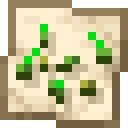

<p align="center"></p>

# Seedscout

> 🇹🇷 Türkçe açıklama aşağıda — [Türkçe](#türkçe)

A **client-side** Fabric mod for Minecraft **26.3** (Java Edition) that adds a seed finder to the
**Create World** screen. The goal is not "OP/cheat" seeds but survival worlds with nice terrain and
useful structures close to spawn — good places to build on.

> **Status:** in development. Stages 1–3 are done: Create World screen controls, structure / biome / spawn
> calculation (verified against `/locate`), seed search and the map preview.

## Requirements

| | |
|---|---|
| Minecraft | 26.3 |
| Fabric Loader | 0.20.1 or newer |
| Fabric API | 0.165.0+26.3 |
| Java | 25 |

Client only — the mod is never needed on a server.

## Features (planned per stage)

1. ✅ **Create World screen** (World tab, under the seed box): `Map` button, `Seed Finder` button, mode
   selector (`Random` / `Speedrun/OP` / `Nice Terrain`) and `Specify` button.
   *Random* is vanilla: Seedscout does not search or change anything.
   With a seed typed into the seed box, only `Map` is shown (the world is already decided).
2. ✅ **Seed Finder** (seed box empty): searches random seeds on several threads with the mode's built-in
   rules. *Speedrun/OP*: a village and a ruined portal within 400 blocks of spawn are required; shipwreck,
   buried treasure, temples, abandoned camps and trail ruins nearby add score; no ocean spawn.
   *Nice Terrain*: a forest within 250 blocks is required; rivers, mountains, cherry groves, meadows and
   villages add score, and the terrain around spawn is measured (water, hills, mountains, flat land).
   Live counter, seeds/second, results by score; `Map` shows a result, `Use Seed` puts it into the seed box.
   (Editing the rules comes in stage 4.)
3. ✅ **Map** (Chunkbase style), for a found seed or the seed in the seed box:
   - coloured biome map around spawn (10,000 blocks radius by default, `mapRadius` in the config),
     spawn marker, structure icons (hover: type, distance and direction from spawn, coordinates);
   - drag to move, mouse wheel to zoom; coarse tiles first, finer ones as you zoom in, all computed
     in the background (the game never freezes);
   - optional height shading and distance rings (100 / 300 / 500 / 1000 blocks);
   - side panel with the nearest structure of every type and the nearest biomes, with distance and
     direction ("Village — 140 blocks, northeast"). Click: the map moves there. Right click: copies
     the matching `/locate` command (run from spawn), to check it in the game;
   - `Copy Seed`, and `Use Seed` when opened from the Seed Finder.
   Explorer-map icons of the game are used where they exist (so resource packs apply).
4. Rule editor (any registered structure/biome, also from data packs and mods).
5. Better terrain scoring, presets, performance and polish.

## How it works (no chunks are generated)

Everything is read from the Create World screen: the selected world type's overworld generator
(normal, large biomes, amplified, …), the registries loaded with the enabled data packs (so data pack and
mod structures/biomes are included) and the "Generate Structures" switch.

For a seed, Seedscout builds the same `RandomState` and `ChunkGeneratorStructureState` as the server, then:

1. **Placement**: the structure set's own placement code gives the candidate chunks (spread regions,
   stronghold rings), including frequency and exclusion zones.
2. **Selection**: for sets with several structures (e.g. the 5 village types), the same weighted random as
   the game picks one.
3. **Validity**: `Structure.findValidGenerationPoint`, the check `/locate` uses (biome, terrain height from
   the noise, jigsaw start piece).
4. **Biomes**: the world's biome source with the climate sampler; **spawn**: `ChunkGenerator.getOrigin`,
   like `MinecraftServer.setInitialSpawn`.

An automated test creates real worlds (normal and large biomes) and compares spawn, 48 structure types,
2000 biome samples and `/locate biome` results with the integrated server: all identical.

## Building

```bash
./gradlew build
```

The mod jar is `build/libs/seedscout-<version>.jar`.

## Testing

```bash
./gradlew runClient
```

Automated in-game tests (they are not part of the mod jar):

```bash
./gradlew runClientGameTest
```

On a headless Linux machine (software OpenGL):

```bash
LIBGL_ALWAYS_SOFTWARE=1 SDL_VIDEO_FORCE_EGL=1 xvfb-run -a -s "-screen 0 1920x1080x24" ./gradlew runClientGameTest
```

## Config

`config/seedscout/settings.json` — last selected mode, number of search / map threads (`0` = automatic:
half of the CPU threads, at most 8) and `mapRadius` (map size around spawn in blocks, default 10000).

## License

MIT.

---

## Türkçe

Minecraft **26.3** (Java Edition) için **sadece istemci tarafında** çalışan bir Fabric modu. **Dünya Oluştur**
ekranına bir seed bulucu ekler. Amaç OP/hile seed'i bulmak değil; survival'da güzel araziye ve iyi yapılara
yakın, üstüne güzel inşaatlar yapılabilecek dünyalar bulmak.

> **Durum:** geliştiriliyor. Aşama 1–3 tamamlandı: Dünya Oluştur ekranı, `/locate` ile doğrulanmış yapı / biyom /
> spawn hesabı, seed arama ve harita önizleme.

### Gereksinimler

| | |
|---|---|
| Minecraft | 26.3 |
| Fabric Loader | 0.20.1 veya daha yeni |
| Fabric API | 0.165.0+26.3 |
| Java | 25 |

Sadece istemci — sunucuya kurmaya gerek yok.

### Özellikler (aşamalara göre plan)

1. ✅ **Dünya Oluştur ekranı** (Dünya sekmesi, seed kutusunun altı): `Harita` butonu, `Seed Bulucu` butonu,
   mod seçimi (`Rastgele` / `Speedrun/OP` / `Güzel Arazi`) ve `Belirle` butonu.
   *Rastgele* vanilla'dır: Seedscout hiçbir arama yapmaz, hiçbir şeyi değiştirmez.
   Seed kutusuna seed yazılıysa sadece `Harita` görünür (dünya zaten belli).
2. ✅ **Seed Bulucu** (seed kutusu boşken): seçili modun hazır kurallarıyla birden fazla thread'de rastgele
   seed'ler dener. *Speedrun/OP*: spawn'a 400 blok içinde köy ve yıkık portal zorunlu; yakındaki batık gemi,
   gömülü hazine, tapınaklar, terk edilmiş kamplar ve patika harabeleri puan verir; okyanusta spawn olmaz.
   *Güzel Arazi*: 250 blok içinde orman zorunlu; nehir, dağ, kiraz bahçesi, çayır ve köy puan verir, spawn
   çevresindeki arazi ölçülür (su, tepeler, dağlar, düz alan). Canlı sayaç, saniyedeki seed, puana göre
   sonuçlar; `Harita` sonucu gösterir, `Seed'i Kullan` seed kutusuna yazar. (Kuralları düzenleme 4. aşamada.)
3. ✅ **Harita** (Chunkbase tarzı), bulunan bir seed ya da seed kutusundaki seed için:
   - spawn çevresinde renkli biyom haritası (varsayılan 10.000 blok yarıçap, ayarlarda `mapRadius`), spawn
     işareti, yapı ikonları (üstüne gelince: tür, spawn'a uzaklık ve yön, koordinat);
   - sürükleyerek kaydırma, fare tekerleğiyle zoom; önce kaba, yaklaştıkça detaylı parçalar, hepsi arka planda
     hesaplanır (oyun donmaz);
   - isteğe bağlı yükseklik gölgelendirmesi ve mesafe halkaları (100 / 300 / 500 / 1000 blok);
   - sağda her yapı türünün ve biyomların spawn'a en yakını, mesafe ve yönüyle ("Köy — 140 blok, kuzeydoğu").
     Tıkla: harita oraya kayar. Sağ tık: ilgili `/locate` komutunu kopyalar (spawn'dan), oyunda kontrol için;
   - `Seed'i Kopyala`, Seed Bulucu'dan açıldıysa `Seed'i Kullan`.
   Oyunun kâşif haritası ikonları varsa onlar kullanılır (resource pack'ler de geçerli olur).
4. Kural düzenleyici (datapack ve modlardakiler dahil kayıtlı tüm yapı/biyomlar).
5. Daha iyi arazi puanlama, preset'ler, performans ve cilalama.

### Nasıl çalışır (chunk oluşturulmaz)

Her şey Dünya Oluştur ekranından okunur: seçilen dünya tipinin overworld üreticisi (normal, büyük biyomlar,
amplified…), etkin datapack'lerle yüklenmiş registry'ler (datapack ve mod yapıları/biyomları da dahil) ve
"Yapıları Oluştur" anahtarı.

Bir seed için sunucuyla aynı `RandomState` ve `ChunkGeneratorStructureState` kurulur, sonra:

1. **Yerleşim**: yapı setinin kendi yerleşim kodu aday chunk'ları verir (dağılım bölgeleri, stronghold
   halkaları); sıklık ve dışlama bölgeleri dahil.
2. **Seçim**: birden fazla yapılı setlerde (ör. 5 köy tipi) oyundaki ağırlıklı rastgele seçimle aynısı yapılır.
3. **Geçerlilik**: `/locate`'in kullandığı `Structure.findValidGenerationPoint` (biyom, gürültüden arazi
   yüksekliği, jigsaw başlangıç parçası).
4. **Biyomlar**: dünyanın biyom kaynağı ve iklim örnekleyicisi; **spawn**: `MinecraftServer.setInitialSpawn`
   gibi `ChunkGenerator.getOrigin`.

Otomatik bir test gerçek dünyalar (normal ve büyük biyomlar) oluşturup spawn, 48 yapı türü, 2000 biyom örneği
ve `/locate biome` sonuçlarını entegre sunucuyla karşılaştırır: hepsi birebir aynı.

### Derleme

```bash
./gradlew build
```

Mod dosyası: `build/libs/seedscout-<sürüm>.jar`.

### Test

```bash
./gradlew runClient
```

Otomatik oyun içi testler (mod jar'ına dahil değildir):

```bash
./gradlew runClientGameTest
```

### Ayarlar

`config/seedscout/settings.json` — son seçilen mod, arama / harita thread sayısı (`0` = otomatik: işlemci
thread'lerinin yarısı, en fazla 8) ve `mapRadius` (spawn çevresindeki harita boyutu, blok; varsayılan 10000).

### Lisans

MIT.
